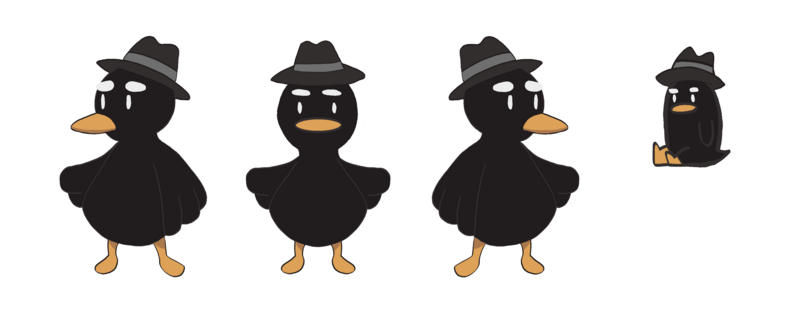

<p align="center">
  
</p>

<h1 align="center">Pwnterrey Badge</h1>
<p align="center">
  <strong>Firmware v2.3.8</strong> · ESP32-C5 · Pwnterrey 2026<br>
  <em>Badge oficial de la comunidad Pwnterrey — basado en ESP32 Marauder</em>
</p>

<p align="center">
  <a href="https://github.com/Wiinsad/pwnterrey-badge/releases/latest">📦 Última versión</a> ·
  <a href="https://wiinsad.github.io/pwnterrey-badge/">⚡ Web Flasher</a> ·
  <a href="https://instagram.com/pwnterrey">Instagram</a> ·
  <a href="https://chat.whatsapp.com/CnUJOXwgPs94dOgPqq2Rxd">WhatsApp</a>
</p>

---

## ✨ Características

- 📡 **Evil Twin / Evil Portal** — Captura de credenciales con portal cautivo personalizado
- 📶 **WiFi Scanner** — Escaneo de redes y estaciones, deauth, beacon spam, probe flood
- 📱 **BLE Spam** — Spam de paquetes BLE (Apple, Google, Samsung, Windows)
- 🗺️ **Wardrive** — Mapeo de redes WiFi con GPS, y wardrive de BLE, exportable a Wigle
- 🔑 **WPS Attack** — Fuerza bruta de PIN y Pixie Dust
- 🏷️ **NFC** — Lectura y escritura de etiquetas
- 📻 **Monitor de señal** — Gráfica de actividad por canal
- 🌐 **Panel web** — Control completo desde `http://192.168.4.1`

> **Todo se opera desde el panel web** en `http://192.168.4.1`, y los resultados
> se guardan en la memoria flash interna del badge. Descarga el concentrado de
> tus pruebas desde el panel cuando termines: el archivo de capturas tiene un
> tope de 8 KB y, al llenarse, **las capturas nuevas se descartan en silencio**.
> Reflashear el firmware también lo sobrescribe, porque `badge-full.bin` incluye
> la partición de datos.

---

## 🚀 Instalación

### Método 1: Web Flasher (Recomendado)

La forma más fácil. Solo necesitas Chrome o Edge.

👉 **[https://wiinsad.github.io/pwnterrey-badge/](https://wiinsad.github.io/pwnterrey-badge/)**

1. Conecta tu badge por USB-C
2. Haz clic en **"Instalar Firmware"**
3. Selecciona el puerto serial
4. Espera ~60 segundos

### Método 2: Terminal con esptool

Instala `esptool` si no lo tienes:

```bash
pip install esptool
```

Descarga `badge-full.bin` desde
[**Releases**](https://github.com/Wiinsad/pwnterrey-badge/releases/latest)
y ejecuta:

```bash
esptool.py --chip esp32c5 --port PUERTO --baud 460800 \
  write_flash --flash_mode dio --flash_freq 80m --flash_size 4MB \
  0x0 badge-full.bin
```

**Puertos según tu sistema operativo:**

| Sistema | Puerto |
|---------|--------|
| 🐧 Linux | `/dev/ttyACM0` |
| 🪟 Windows | `COM3` |
| 🍎 macOS | `/dev/cu.usbmodem*` |

> **Tip:** En Linux, si no detecta el puerto, agrega tu usuario al grupo dialout:
> ```bash
> sudo usermod -aG dialout $USER
> ```

### Método 3: Flash individual (binarios separados)

Si necesitas flashear cada partición por separado:

```bash
esptool.py --chip esp32c5 --port PUERTO --baud 460800 \
  write_flash --flash_mode dio --flash_freq 80m --flash_size 4MB \
  0x2000 esp32_marauder.ino.bootloader.bin \
  0x8000 esp32_marauder.ino.partitions.bin \
  0x10000 esp32_marauder.ino.bin \
  0x310000 spiffs.bin
```

---

## 📲 Primer uso

El badge no tiene pantalla: su única interfaz es el panel web.

1. **Conecta el badge por USB-C** — arranca solo y levanta su propia red WiFi
2. **Conéctate a esa red:**
   - **Red:** `PWNTERREY-XXXX` (las X son únicas de cada badge)
   - **Contraseña:** `pwnterrey2026`
3. **Abre el panel:** navega a `http://192.168.4.1`
4. **Explora:** desde ahí lanzas los escaneos y ataques, y revisas resultados

---

## 🔧 Compilar desde código fuente

### Requisitos

- [arduino-cli](https://arduino.github.io/arduino-cli/)
- Core ESP32 **3.3.7 o superior** (el ESP32-C5 no existe en versiones anteriores)

### Pasos

```bash
# Instalar el core de ESP32
arduino-cli core install esp32:esp32

# Clonar este repo
git clone https://github.com/Wiinsad/pwnterrey-badge.git
cd pwnterrey-badge

# Compilar
arduino-cli compile \
  --fqbn esp32:esp32:esp32c5:CDCOnBoot=cdc,FlashFreq=80,PSRAM=disabled,FlashSize=4M,FlashMode=dio,DebugLevel=none,PartitionScheme=huge_app \
  src/esp32_marauder.ino
```

> **Las opciones del `--fqbn` no son opcionales.** La aplicación pesa ~1.8 MB y
> no cabe en el esquema de particiones por omisión, por eso hace falta
> `PartitionScheme=huge_app`. El badge tampoco lleva PSRAM, así que
> `PSRAM=disabled` es obligatorio o el arranque falla.

```bash
# Flashear
arduino-cli upload \
  --fqbn esp32:esp32:esp32c5:CDCOnBoot=cdc,FlashFreq=80,PSRAM=disabled,FlashSize=4M,FlashMode=dio,DebugLevel=none,PartitionScheme=huge_app \
  --port /dev/ttyACM0 src/esp32_marauder.ino
```

### Generar SPIFFS

La partición SPIFFS de `huge_app` mide `0xE0000` (917504 bytes) y vive en
`0x310000`:

```bash
# Crear imagen SPIFFS con los archivos de data/
mkspiffs -c data/ -b 4096 -p 256 -s 0xE0000 spiffs.bin

# Flashear SPIFFS
esptool.py --chip esp32c5 --port /dev/ttyACM0 --baud 460800 \
  write_flash 0x310000 spiffs.bin
```

---

## 📁 Estructura del proyecto

```
pwnterrey-badge/
├── src/              # Código fuente del firmware
│   ├── esp32_marauder.ino
│   ├── WiFiScan.cpp/h
│   ├── EvilPortal.cpp/h
│   ├── CommandLine.cpp/h
│   └── ...
├── data/             # Archivos SPIFFS (panel web)
│   ├── portal.html
│   ├── app.js
│   └── ...
├── release/          # Binarios pre-compilados
│   ├── badge-full.bin
│   ├── manifest.json
│   └── flash.html
├── assets/           # Logo y recursos
├── index.html        # Web flasher (GitHub Pages)
├── README.md
└── LICENSE
```

---

## ❓ Solución de problemas

### El badge no es detectado por USB

- Asegúrate de usar un cable **USB-C con datos** (no solo carga)
- En Linux: `sudo dmesg | tail` para ver si el dispositivo aparece

### Error "Failed to connect" al flashear

- Mantén presionado **BOOT** mientras conectas el USB, y suéltalo cuando inicie
  la descarga
- Reduce la velocidad: cambia `460800` por `115200`

### El Web Flasher no muestra el botón

- Usa **Google Chrome** o **Microsoft Edge** (Firefox no soporta Web Serial)
- Asegúrate de acceder por **HTTPS** (no HTTP)

### No puedo conectarme al WiFi del badge

- Busca la red `PWNTERREY-XXXX` (las X son caracteres únicos del badge)
- Contraseña: `pwnterrey2026`
- Si no aparece, desconecta y reconecta el USB

### El panel web no carga

- Verifica que el SPIFFS se flasheó correctamente
- Intenta borrar la flash completa primero:
  ```bash
  esptool.py --chip esp32c5 --port PUERTO erase_flash
  ```
  Y luego flashea de nuevo con `badge-full.bin`

### El portal cautivo no abre solo en mi iPhone

Si probaste versiones anteriores a la v2.3.8 con el mismo SSID, tu teléfono pudo
guardar el veredicto de que esa red tiene internet y ya no muestra la hoja de
login al reconectar. Usa **"Olvidar esta red"**, o lanza el Evil Twin con un
SSID que ese teléfono nunca haya visto.

---

## 🏆 Créditos

- **[Electronic Cats](https://github.com/ElectronicCats)** — Diseño de hardware
- **Pwnterrey Team** — Personalización del firmware y diseño del badge
- **RF Village** — Colaboración en el desarrollo del badge
- **[justcallmekoko](https://github.com/justcallmekoko)** — Creador de [ESP32 Marauder](https://github.com/justcallmekoko/ESP32Marauder)

### 🔗 Enlaces

- 📱 [Instagram @pwnterrey](https://instagram.com/pwnterrey)
- 💬 [Comunidad WhatsApp](https://chat.whatsapp.com/CnUJOXwgPs94dOgPqq2Rxd)
- ⚡ [Web Flasher](https://wiinsad.github.io/pwnterrey-badge/)

---

## ⚖️ Uso responsable

Este firmware incluye herramientas de ataque a redes inalámbricas. Úsalo
únicamente sobre infraestructura propia o con autorización escrita del
responsable. Operarlo contra redes de terceros sin permiso es ilegal en México y
en la mayoría de los países.

---

## 📄 Licencia

Este proyecto está bajo la [Licencia MIT](LICENSE).

---

<p align="center">
  <strong>Hecho con 🦆 por la comunidad Pwnterrey</strong><br>
  <em>Monterrey, México · 2026</em>
</p>
